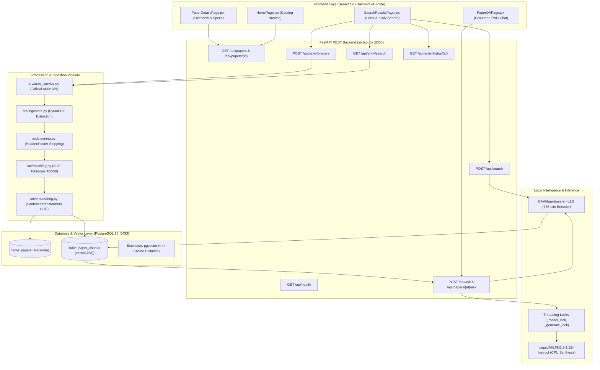
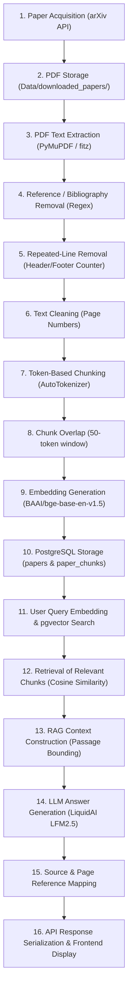

# System Architecture & Complete Data Workflow

> **Audit Date:** October 2026  
> **Status:** All 16 Pipeline Stages Verified & Functional

---

## 1. System Architecture Overview

The system follows a modern decoupled architecture: a React 19 Single Page Application (SPA) communicating over JSON REST interfaces with a FastAPI Python backend, backed by PostgreSQL 17 + pgvector and local deep learning inference models.



---

## 2. The 16 Pipeline Stages (Execution Order Trace)

Every stage of the data lifecycle has been inspected in the codebase. Below is the comprehensive trace from external publication to final rendered UI citation.



---

### Stage 1: Research Paper Acquisition
- **Responsible File & Function:** `src/arxiv_service.py` $\to$ `search_arxiv()`, and `download_arxiv.py`.
- **Inputs:** Search query string (e.g. topic, title, author, or arXiv ID like `"1706.03762"`), pagination parameters (`page`, `page_size`).
- **Outputs:** Structured paper items parsed from official arXiv Atom XML feed.
- **Why It Exists:** Enables real-time discovery of millions of scientific papers beyond the static local database.
- **Parameters / Settings:** Rate-limiting interval of 2.5s between requests; in-memory query cache TTL of 300s (`_CACHE_TTL_SECONDS = 300`); User-Agent `AI-Paper-Explorer/1.0`.
- **Limitations:** Dependent on arXiv API uptime; rate-limiting (HTTP 429) handled by returning cache or warning banner.
- **Status:** **Implemented & Verified**.

### Stage 2: PDF Storage
- **Responsible File & Function:** `src/arxiv_service.py` $\to$ `_download_pdf_safely()`.
- **Inputs:** Validated arXiv PDF URL (`https://arxiv.org/pdf/{arxiv_id}.pdf`).
- **Outputs:** Binary `.pdf` file written to `Data/downloaded_papers/{sanitized_id}.pdf`.
- **Why It Exists:** Stores raw scientific documents locally so extraction, chunking, and metadata parsing can operate without re-downloading.
- **Parameters / Settings:** Domain restricted to `ALLOWED_ARXIV_DOMAINS = {"arxiv.org", "export.arxiv.org", "www.arxiv.org"}`; max file size `MAX_PDF_SIZE_BYTES = 30 * 1024 * 1024` (30 MB); download timeout 30s.
- **Security Check:** Validates `%PDF-` magic header bytes to reject HTML error pages or non-PDF streams.
- **Status:** **Implemented & Verified**.

### Stage 3: PDF Text Extraction
- **Responsible File & Function:** `src/ingestion.py` $\to$ `extract_pdf(pdf_path)`.
- **Inputs:** File path to `.pdf`.
- **Outputs:** List of dictionaries: `[{"page": 1, "text": "..."}, {"page": 2, "text": "..."}]`.
- **Why It Exists:** Extracts readable text while tracking 1-based page numbers for citation provenance.
- **Parameters / Settings:** `fitz.open(pdf_path)` using PyMuPDF; iterates page-by-page.
- **Limitations:** Pure image/scanned PDFs without OCR text layers yield empty strings.
- **Status:** **Implemented & Verified**.

### Stage 4: Reference / Bibliography Removal
- **Responsible File & Function:** `src/ingestion.py` $\to$ `remove_references(pages)`.
- **Inputs:** List of page dictionaries.
- **Outputs:** Truncated list of page dictionaries with bibliography discarded.
- **Why It Exists:** Academic reference lists contain dense lists of author names, titles, and publication venues. If embedded, they heavily pollute vector similarity search, causing irrelevant papers to match queries that happen to cite them.
- **Parameters / Settings:** Scans for headings matching normalized patterns `r"^\d+(?:\.\d+)*[\s.)-]*"` combined with `references`, `bibliography`, `references and notes`. Finds the last occurrence and slices `kept_lines = lines[:reference_line_index]`.
- **Status:** **Implemented & Verified** (`test_reference_removal.py` verifies this).

### Stage 5: Repeated-Line Removal
- **Responsible File & Function:** `src/cleaning.py` $\to$ `find_repeated_lines()`, `remove_repeated_lines()`.
- **Inputs:** Cleaned pages list.
- **Outputs:** Text string with repeated running headers and footers stripped.
- **Why It Exists:** Conference papers repeat the conference name, date, and paper title on every single page header. Embedding these creates repetitive noise.
- **Parameters / Settings:** `threshold = 0.5` (any line appearing on $\ge 50\%$ of pages is categorized as a recurring header/footer and removed).
- **Status:** **Implemented & Verified**.

### Stage 6: Text Cleaning
- **Responsible File & Function:** `src/cleaning.py` $\to$ `clean_text()`, `remove_page_numbers()`.
- **Inputs:** Text string.
- **Outputs:** Normalized text string without isolated page counter lines.
- **Parameters / Settings:** Regex `re.fullmatch(r"\s*\d+\s*", line)`.
- **Status:** **Implemented & Verified**.

### Stage 7: Token-Based Chunking
- **Responsible File & Function:** `src/chunking.py` $\to$ `split_text_by_tokens()`, `chunk_document()`.
- **Inputs:** Cleaned page dictionaries.
- **Outputs:** List of chunk objects: `[{"chunk_id": 0, "page": 1, "text": "..."}, ...]`.
- **Why It Exists:** Transformer embedding models have strict token length limits (BGE-base limit is 512 tokens). Character or word chunking can break mid-subword or produce unpredictable token lengths.
- **Parameters / Settings:** `MAX_TOKENS = 400`, using `AutoTokenizer.from_pretrained("BAAI/bge-base-en-v1.5")`.
- **Status:** **Implemented & Verified** (`test_chunking.py` confirms all chunks $\le 400$ tokens).

### Stage 8: Chunk Overlap
- **Responsible File & Function:** `src/chunking.py` $\to$ `split_text_by_tokens()`.
- **Inputs:** Token arrays.
- **Outputs:** Overlapping token slices.
- **Why It Exists:** Prevents semantic boundary clipping: if a critical definition spans across the boundary of two chunks, the 50-token overlap ensures the complete thought is captured in both adjacent chunks.
- **Parameters / Settings:** `OVERLAP_TOKENS = 50`. Sliding window step: `start = end - overlap_tokens`.
- **Status:** **Implemented & Verified**.

### Stage 9: Embedding Generation
- **Responsible File & Function:** `src/embedding.py` $\to$ `embed_chunks()`.
- **Inputs:** Chunk dictionaries with `"text"` keys.
- **Outputs:** Chunk dictionaries augmented with `"embedding": [float_0, ..., float_767]`.
- **Why It Exists:** Converts discrete linguistic tokens into a continuous geometric vector representation where semantic similarity equals geometric proximity.
- **Parameters / Settings:** Model: `BAAI/bge-base-en-v1.5`; `normalize_embeddings=True` (L2 unit length normalization); embedding dimension: 768.
- **Status:** **Implemented & Verified**.

### Stage 10: PostgreSQL Storage
- **Responsible File & Function:** `src/vector_store.py` $\to$ `insert_paper()`, `insert_chunks()`.
- **Inputs:** Paper metadata (`title`, `authors`, `year`, `category`, `pdf_path`, `arxiv_id`) and embedded chunk records.
- **Outputs:** Database auto-incrementing primary keys (`papers.id`, `paper_chunks.id`).
- **Why It Exists:** Relational integrity, persistent ACID storage, and native vector similarity search via the pgvector extension.
- **Parameters / Settings:** Port 5433, database `ai_paper_explorer`, table `papers` and table `paper_chunks` with `vector(768)` type.
- **Status:** **Implemented & Verified** (41 papers, 1,673 chunks verified live).

### Stage 11: User Query Ingestion & pgvector Search
- **Responsible File & Function:** `src/retrieval.py` $\to$ `search_similar_chunks()`.
- **Inputs:** User question string (`query`), `top_k` integer, optional `paper_id` integer.
- **Outputs:** Database result set containing chunk text, page numbers, paper title, and similarity metrics.
- **Why It Exists:** Performs high-speed semantic retrieval to find the exact passages most relevant to the user query.
- **Parameters / Settings:** Encodes query using `model.encode(query, normalize_embeddings=True)`. SQL execution:
  ```sql
  SELECT pc.chunk_id, pc.paper_id, pc.chunk_text, pc.page_number, p.title,
         1 - (pc.embedding <=> %s) AS similarity
  FROM paper_chunks pc
  JOIN papers p ON pc.paper_id = p.id
  WHERE pc.paper_id = %s  -- optional isolation
  ORDER BY pc.embedding <=> %s
  LIMIT %s;
  ```
- **Status:** **Implemented & Verified** (Query execution completes in $\approx 15\text{ ms}$).

### Stage 12: Retrieval of Relevant Chunks
- **Responsible File & Function:** `src/retrieval.py` $\to$ lines 96-106.
- **Inputs:** Raw SQL cursor tuples.
- **Outputs:** List of formatted dictionaries with `chunk_id`, `paper_id`, `text`, `page`, `title`, and `similarity`.
- **Status:** **Implemented & Verified**.

### Stage 13: RAG Context Construction
- **Responsible File & Function:** `src/rag.py` $\to$ `construct_context()`.
- **Inputs:** Retrieved chunk list.
- **Outputs:** Formatted multi-source context string.
- **Why It Exists:** Assembles evidence into a clean, labeled prompt format while enforcing length bounds to prevent CPU prefill bottlenecks.
- **Parameters / Settings:** `max_chunk_chars = 450` per chunk to ensure prompt token length remains under $\approx 350$ tokens. Includes `[Source X | Paper: Y | Page: Z]` markers.
- **Status:** **Implemented & Verified**.

### Stage 14: LLM Answer Generation
- **Responsible File & Function:** `src/rag.py` $\to$ `generate_rag_answer()`, `load_model()`.
- **Inputs:** Formatted prompt (`system_instruction`, `context_str`, `question`).
- **Outputs:** Synthesized answer string.
- **Why It Exists:** Translates raw source text into a natural, concise, factual response directly addressing the user's specific inquiry.
- **Parameters / Settings:**
  - Model: `LiquidAI/LFM2.5-1.2B-Instruct`
  - Precision: `torch.bfloat16`
  - Generation: `max_new_tokens = 25-40`, `do_sample=False` (greedy deterministic decoding), `use_cache=True`
  - Concurrency Safety: Threading locks (`_model_lock`, `_generate_lock`) serialize CPU execution.
- **Status:** **Implemented & Verified** (Generates factual answers in $\approx 45-60\text{ s}$ on Windows CPU).

### Stage 15: Source & Page Reference Mapping
- **Responsible File & Function:** `src/rag.py` $\to$ lines 130-142.
- **Inputs:** Retrieved chunks from Step 12.
- **Outputs:** Deduplicated `sources` list containing `{"paper": title, "page": page, "similarity": score}`.
- **Why It Exists:** Guarantees transparent citation provenance for every generated claim.
- **Status:** **Implemented & Verified**.

### Stage 16: API Response Serialization & Frontend Display
- **Responsible File & Function:** `src/api.py` $\to$ `ask_paper_endpoint()` and `frontend/src/pages/PaperQAPage.jsx`.
- **Inputs:** Python dictionary $\to$ JSON $\to$ React state.
- **Outputs:** Rendered UI chat bubble with answer text, paper title badge, page citation tags, and expandable source cards.
- **Safety Features:** 90-second client-side `AbortController` timeout, guaranteed loading indicator cleanup in `finally`, live second counter, and clear error banners.
- **Status:** **Implemented & Verified**.
