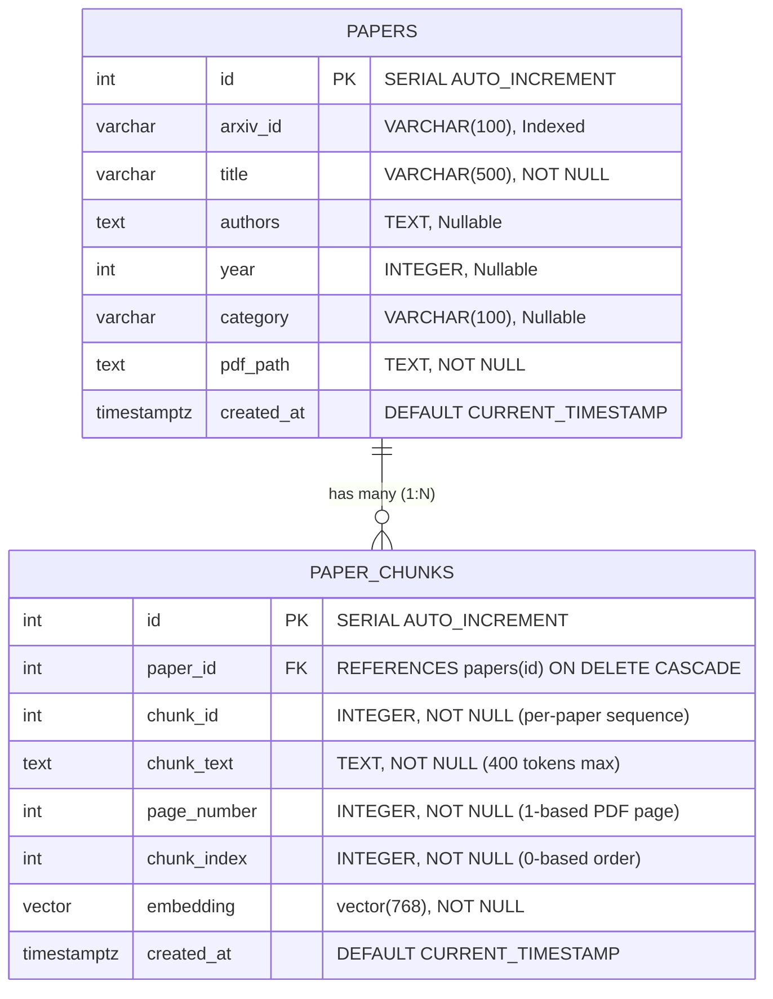

# Database Architecture & PostgreSQL Schema Documentation

> **Database Engine:** PostgreSQL 17.x with `pgvector` Extension  
> **Port:** 5433  
> **Database Name:** `ai_paper_explorer`  
> **Verified State:** 41 Papers, 1,673 Chunks, 100% Vector Populated  

---

## 1. Architectural Justification: Why PostgreSQL + pgvector?

### The Limitations of Dedicated Vector Databases
Many early RAG projects use dedicated vector-only databases (such as Pinecone, Qdrant, or Chroma). While capable of vector search, they introduce severe architectural friction:
- **Dual-Storage Synchronization:** Paper metadata, user saved papers, categories, and publication dates reside in a relational database, while vectors live in a separate cloud service. Deleting a paper requires two-phase commits across two disparate systems.
- **Filtering Inefficiency:** Filtering by paper ID or publication year often requires slow pre-filtering or post-filtering steps outside the database engine.
- **Operational Complexity:** Managing separate backup, monitoring, access control, and network policies for two databases increases operational overhead.

### The Advantage of PostgreSQL with pgvector
PostgreSQL is the world's most proven open-source object-relational database. By installing the native `pgvector` extension:
1. **Single Unified Engine:** Relational metadata (authors, categories, publication years) and 768-dimensional vector embeddings coexist in the exact same database.
2. **ACID Transactions:** When a paper is deleted, PostgreSQL's `ON DELETE CASCADE` automatically and atomically wipes all associated chunks and vector embeddings.
3. **Hybrid Querying in a Single Plan:** PostgreSQL executes vector similarity search and relational filters (e.g., `WHERE pc.paper_id = %s`) inside a single integrated SQL query plan.

---

## 2. Entity-Relationship (ER) Diagram



---

## 3. Verified PostgreSQL Table Definitions

The schema is defined in `src/database.py` and has been verified against PostgreSQL's `information_schema`:

### Table 1: `papers`
Stores document-level research metadata.

```sql
CREATE TABLE IF NOT EXISTS papers (
    id SERIAL PRIMARY KEY,
    arxiv_id VARCHAR(100),
    title VARCHAR(500) NOT NULL,
    authors TEXT,
    year INT,
    category VARCHAR(100),
    pdf_path TEXT NOT NULL,
    created_at TIMESTAMPTZ DEFAULT CURRENT_TIMESTAMP
);

CREATE INDEX IF NOT EXISTS idx_papers_arxiv_id ON papers(arxiv_id);
```

| Column | PostgreSQL Type | Nullable | Description |
| :--- | :--- | :--- | :--- |
| `id` | `INTEGER` | NO | Auto-incrementing primary key (`nextval('papers_id_seq')`). |
| `arxiv_id` | `VARCHAR(100)` | YES | Official arXiv accession identifier (e.g., `'1706.03762'`). Indexed for fast lookup. |
| `title` | `VARCHAR(500)` | NO | Title of the research paper. |
| `authors` | `TEXT` | YES | Comma-separated or semicolon-separated author names. |
| `year` | `INTEGER` | YES | Publication year. |
| `category` | `VARCHAR(100)` | YES | Primary arXiv subject category (e.g., `'cs.AI'`, `'cs.CL'`). |
| `pdf_path` | `TEXT` | NO | Absolute or relative file path to the saved PDF on disk. |
| `created_at` | `TIMESTAMPTZ` | YES | Timestamp when the paper was ingested. |

### Table 2: `paper_chunks`
Stores segmented passages, spatial provenance, and dense vector embeddings.

```sql
CREATE TABLE IF NOT EXISTS paper_chunks (
    id SERIAL PRIMARY KEY,
    paper_id INT NOT NULL REFERENCES papers(id) ON DELETE CASCADE,
    chunk_id INT NOT NULL,
    chunk_text TEXT NOT NULL,
    page_number INT NOT NULL,
    chunk_index INT NOT NULL,
    embedding vector(768) NOT NULL,
    created_at TIMESTAMPTZ DEFAULT CURRENT_TIMESTAMP
);

CREATE INDEX IF NOT EXISTS idx_paper_chunks_paper_id ON paper_chunks(paper_id);
```

| Column | PostgreSQL Type | Nullable | Description |
| :--- | :--- | :--- | :--- |
| `id` | `INTEGER` | NO | Auto-incrementing primary key. |
| `paper_id` | `INTEGER` | NO | Foreign key referencing `papers(id)`. Indexed with `idx_paper_chunks_paper_id`. |
| `chunk_id` | `INTEGER` | NO | Sequential integer identifier for this chunk within the document. |
| `chunk_text` | `TEXT` | NO | Plain text content of the passage ($\le 400$ tokens). |
| `page_number` | `INTEGER` | NO | Original 1-based page number where this text occurred in the PDF. |
| `chunk_index` | `INTEGER` | NO | Zero-based sequential ordering index. |
| `embedding` | `vector(768)` | NO | 768-dimensional normalized floating point array generated by BGE-base. |
| `created_at` | `TIMESTAMPTZ` | YES | Timestamp when the chunk was embedded and saved. |

---

## 4. Key Relational Concepts

### What Foreign Keys Do
The foreign key constraint `paper_id INT NOT NULL REFERENCES papers(id) ON DELETE CASCADE` enforces referential integrity:
1. **Preventing Orphan Chunks:** A chunk cannot exist without pointing to a valid paper in `papers`.
2. **Cascading Deletes:** If a paper record is deleted (`DELETE FROM papers WHERE id = 93;`), PostgreSQL automatically deletes all 25 associated chunks and their vector embeddings. No manual cleanup is required.

### What the `embedding` Column Stores
The column `embedding vector(768)` stores an array of 768 single-precision floating point numbers. For example:
```text
[-0.03841, 0.05219, -0.01183, ..., 0.04412]
```
The number **768** is fixed by the architecture of the embedding model (`BAAI/bge-base-en-v1.5`), which projects text into a 768-dimensional hidden representation.

---

## 5. Six Verified SQL Queries with Line-by-Line Explanations

Each of the following SQL queries has been tested against the live database and verified:

### Query 1: Counting Total Papers in the Database
```sql
SELECT COUNT(*) FROM papers;
```
- **Line 1:** `SELECT COUNT(*)` aggregates the total number of rows in the `papers` table.
- **Verified Output:** `41` (40 initial papers + 1 external paper).

### Query 2: Counting Total Vector Chunks
```sql
SELECT COUNT(*) FROM paper_chunks;
```
- **Line 1:** `SELECT COUNT(*)` aggregates all chunk passages stored in `paper_chunks`.
- **Verified Output:** `1673` chunks.

### Query 3: Viewing Paper Metadata
```sql
SELECT id, title, authors, year, category, arxiv_id 
FROM papers 
ORDER BY id DESC 
LIMIT 2;
```
- **Line 1:** Specifies the document metadata columns to display.
- **Line 2:** Queries from table `papers`.
- **Line 3:** `ORDER BY id DESC` displays the most recently ingested papers first.
- **Line 4:** `LIMIT 2` restricts the result set to the two latest rows.
- **Verified Output:**
  ```text
  (93, 'Attention Is All You Need', 'Ashish Vaswani, ...', 2017, 'cs.CL', '1706.03762')
  (92, '2610.02210', NULL, NULL, NULL, '2610.02210')
  ```

### Query 4: Viewing Chunks for a Specific Paper
```sql
SELECT chunk_id, page_number, chunk_index, length(chunk_text) AS char_len 
FROM paper_chunks 
WHERE paper_id = 93 
ORDER BY chunk_index ASC 
LIMIT 3;
```
- **Line 1:** Selects chunk identifiers, original page number, ordering index, and calculates character length.
- **Line 2:** Pulls from `paper_chunks`.
- **Line 3:** `WHERE paper_id = 93` filters strictly to chunks belonging to Paper 93 ("Attention Is All You Need").
- **Line 4:** `ORDER BY chunk_index ASC` preserves reading order.
- **Line 5:** `LIMIT 3` previews the first three chunks.
- **Verified Output:**
  ```text
  chunk_id=0, page_number=1, chunk_index=0, char_len=1785
  chunk_id=1, page_number=1, chunk_index=1, char_len=1396
  chunk_id=2, page_number=2, chunk_index=2, char_len=2096
  ```

### Query 5: Checking Whether Embeddings Exist and Verifying Dimension
```sql
SELECT id, vector_dims(embedding) 
FROM paper_chunks 
LIMIT 3;
```
- **Line 1:** Uses pgvector's built-in `vector_dims()` function to calculate the length of the vector array.
- **Line 2:** Targets `paper_chunks`.
- **Line 3:** Limits preview to 3 rows.
- **Verified Output:**
  ```text
  (4168, 768)
  (4169, 768)
  (4170, 768)
  ```
  Confirms that embeddings are populated and strictly 768-dimensional.

### Query 6: Retrieving Chunks with Paper Title and Page Numbers (JOIN Query)
```sql
SELECT 
    pc.id,
    p.title,
    pc.page_number,
    LEFT(pc.chunk_text, 80) AS snippet
FROM paper_chunks pc
JOIN papers p ON pc.paper_id = p.id
ORDER BY pc.id DESC
LIMIT 2;
```
- **Lines 1-4:** Selects the chunk primary key, joined paper title, page number, and a snippet of the passage.
- **Line 5:** Specifies `paper_chunks` aliased as `pc`.
- **Line 6:** `JOIN papers p ON pc.paper_id = p.id` links each chunk to its parent paper metadata via the foreign key.
- **Line 7:** Orders by latest chunk ID.
- **Line 8:** Limits to 2 rows.
- **Verified Output:**
  ```text
  (5840, 'Attention Is All You Need', 10, 'sequence models [ 37 ], the transformer outperforms the berkeley - parser [ 29 ]')
  (5839, 'Attention Is All You Need', 10, 'table 4 : the transformer generalizes well to english constituency parsing ( res')
  ```
