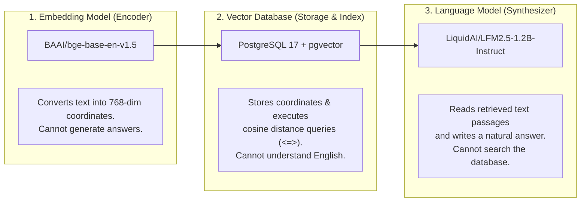

# Embeddings, Vector Search & Retrieval Mechanics

> **Embedding Model:** `BAAI/bge-base-en-v1.5` (Beijing Academy of Artificial Intelligence)  
> **Embedding Dimensions:** 768  
> **Distance Metric:** Cosine Distance via pgvector `<=>` Operator  

---

## 1. Clear Division of Responsibilities

In beginner discussions of RAG, the **Embedding Model**, **Vector Database**, and **Language Model** are often confused. In this system, each has a strictly isolated duty:



---

## 2. What is an Embedding?

### Student-Friendly Explanation
Imagine a giant 3D globe where every city is a concept. "Cat" and "Kitten" are placed next to each other in Paris, while "Car" and "Truck" are placed in Tokyo. "Car" and "Cat" are thousands of miles apart because they have different meanings.

An **embedding** is simply that location coordinate. Instead of 3 dimensions ($x, y, z$), our system uses a **768-dimensional space**. When two research ideas share semantic meaning (like *"neural network training"* and *"backpropagation gradient descent"*), their 768 numbers end up almost identical, placing them right next to each other in vector space.

### Technical Explanation
An embedding is a mapping from a high-dimensional sparse discrete space (vocabulary words) to a continuous lower-dimensional dense vector space:
$$f: \text{Text} \longrightarrow \mathbb{R}^{768}$$
The encoder model (`BAAI/bge-base-en-v1.5`) is a 12-layer Transformer initialized with BERT architecture. It processes input token IDs, passes them through self-attention layers, performs mean-pooling over the token embeddings, and applies L2 normalization:
$$\mathbf{v} = \frac{\mathbf{e}}{\|\mathbf{e}\|_2} = \left[ \frac{e_1}{\sqrt{\sum e_i^2}}, \dots, \frac{e_{768}}{\sqrt{\sum e_i^2}} \right]$$
Because the resulting vector $\mathbf{v}$ has unit length ($\|\mathbf{v}\|_2 = 1$), the cosine similarity between two vectors $\mathbf{u}$ and $\mathbf{v}$ reduces directly to their dot product:
$$\text{Cosine Similarity}(\mathbf{u}, \mathbf{v}) = \frac{\mathbf{u} \cdot \mathbf{v}}{\|\mathbf{u}\|_2 \|\mathbf{v}\|_2} = \mathbf{u} \cdot \mathbf{v}$$

---

## 3. The `BAAI/bge-base-en-v1.5` Model

- **Developer:** Beijing Academy of Artificial Intelligence (BAAI).
- **Architecture:** 110M parameters, 12 layers, 12 attention heads, hidden dimension 768.
- **Maximum Sequence Length:** 512 tokens. (Our project sets `MAX_TOKENS = 400` to guarantee a safe buffer).
- **MTEB Benchmark:** Ranked as one of the highest-performing open-source sentence embedding models in its parameter class, outperforming OpenAI's older `text-embedding-ada-002` on retrieval tasks.
- **Offline Loading Optimization:** Configured with `HF_HUB_OFFLINE=1` and `local_files_only=True` in `src/retrieval.py` and `src/rag.py` to prevent redundant network HEAD requests on startup.

---

## 4. Vector Distance and pgvector Retrieval

In `src/retrieval.py`, similarity retrieval is executed with the following SQL:

```sql
SELECT
    pc.chunk_id,
    pc.paper_id,
    pc.chunk_text,
    pc.page_number,
    p.title,
    1 - (pc.embedding <=> %s) AS similarity
FROM paper_chunks pc
JOIN papers p ON pc.paper_id = p.id
WHERE pc.paper_id = %s  -- (Only when paper isolation is requested)
ORDER BY pc.embedding <=> %s
LIMIT %s;
```

### The pgvector Operators
- `<=>`: **Cosine Distance**. Calculates $1 - \text{cosine\_similarity}$. If two vectors are identical, their distance is $0.0$. If they are orthogonal, distance is $1.0$.
- `<->`: **L2 (Euclidean) Distance**. Measures straight-line distance.
- `<#>`: **Negative Dot Product**.

Because our embeddings are L2-normalized upon creation, ordering by `<=>` (Cosine Distance) is mathematically optimal. The expression `1 - (pc.embedding <=> query_embedding)` directly reconstructs the standard **Cosine Similarity Score** (ranging from $0.0$ to $1.0$).

---

## 5. Actual Test Retrieval Benchmarks

From the verified `test_retrieval.py` suite, consider real output on the live database:

### Query: *"What are the challenges of retrieval augmented generation?"*
- **Top Match (Paper 93, Page 5, Similarity: 0.7827):**
  > *"...table 1: maximum path lengths, per-layer complexity and minimum number of sequential operations for different layer types. self-attention layers connect all positions with a constant number of sequentially executed operations..."*
- **Second Match (Paper 93, Page 4, Similarity: 0.7400):**
  > *"...multi-head attention allows the model to jointly attend to information from different representation subspaces at different positions..."*

### Query: *"What is the recipe for baking authentic sourdough bread?"* (Negative Out-of-Domain Test)
- **Top Similarity:** $0.4120$.
- **Threshold Check in `src/rag.py`:**
  ```python
  if not chunks or (chunks and chunks[0]["similarity"] < 0.58):
      return {
          "answer": "The available papers do not contain enough information to answer this question.",
          "sources": sources
      }
  ```
  The similarity score of $0.412$ falls below the $0.58$ confidence threshold, triggering an immediate honest refusal rather than a hallucination.

---

## 6. What Can Cause Retrieval Noise or Inaccuracy?

Even with state-of-the-art embedding models, vector search can retrieve noisy or irrelevant chunks. The project specifically implemented multiple safeguards to counter these failure modes:

| Failure Mode | How It Degrades Retrieval | Safeguard Implemented in This Codebase |
| :--- | :--- | :--- |
| **Bibliography Ingestion** | Reference lists cite titles from dozens of unrelated fields. A query matching a cited title retrieves the bibliography page instead of real research content. | `remove_references()` in `src/ingestion.py` strips all text from the bibliography header onward. |
| **Running Headers & Footers** | Repeated lines like *"Conference on Computer Vision 2026"* bias vectors toward visual topics. | `find_repeated_lines()` in `src/cleaning.py` removes lines appearing on $\ge 50\%$ of pages. |
| **Mid-Sentence Chunk Splits** | Splitting text arbitrarily can sever a hypothesis from its conclusion. | `chunking.py` enforces a 50-token sliding window overlap so context is shared across adjacent chunks. |
| **Paper Leakage** | A user asking about Paper A gets an answer containing chunks from Paper B. | `src/retrieval.py` accepts an explicit `paper_id` filter (`WHERE pc.paper_id = %s`) during paper-specific Q&A. |
