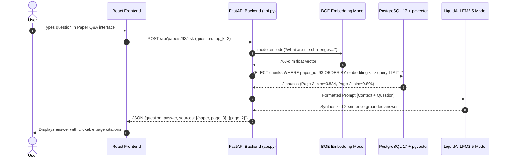
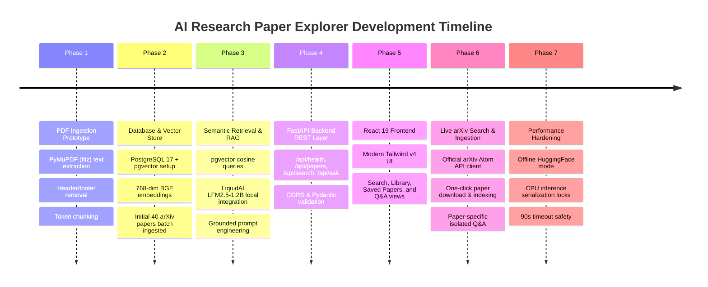

# AI Research Paper Explorer — Project Overview

> **Version:** 1.0.0  
> **Status:** Fully Integrated & Operational  
> **Target Audience:** Researchers, Software Engineers, AI/ML Students, Literature Reviewers  

---

## 1. Executive Summary

The **AI Research Paper Explorer** is a full-stack, retrieval-augmented intelligence platform designed to address the challenges of exploring, searching, and understanding scientific literature. Combining modern dense vector retrieval with local large language model (LLM) instruction synthesis, the application allows users to:

1. **Explore a Curated Vector Library:** Browse and search a local corpus of 41 peer-reviewed AI/ML research papers (comprising 1,673 chunked and embedded passages) stored in **PostgreSQL 17** with the **pgvector** extension.
2. **Discover External Literature via Live arXiv Integration:** Search millions of external research papers directly using the official arXiv API by topic, title, author, or arXiv ID (e.g., `1706.03762`).
3. **On-Demand Automated Document Ingestion:** Download, sanitize, extract, clean, tokenize, embed, and index external arXiv papers into the vector database in real-time with a single click.
4. **Grounded Question Answering (RAG):** Ask natural-language research questions against the entire database or isolated to a specific paper. Answers are strictly grounded in retrieved document chunks and accompanied by exact page numbers and cosine similarity scores to eliminate hallucinations.

---

## 2. The Problem It Solves

### The Challenge of Modern Scientific Literature
Every month, thousands of machine learning and artificial intelligence papers are submitted to preprint servers like arXiv. Researchers and practitioners face critical bottlenecks:

- **Information Overload:** Keeping up with foundational architectures, loss functions, benchmark results, and hyperparameter choices requires reading hundreds of PDF pages.
- **Keyword Search Failures:** Traditional lexical search (e.g., Ctrl+F or basic SQL `LIKE` queries) requires exact keyword matches. If a user searches for *"challenges in neural retrieval"*, lexical search fails to match papers discussing *"dense vector misalignment"* or *"out-of-distribution passage degradation"* even though the semantic meaning is identical.
- **LLM Hallucinations:** Asking general-purpose chatbots (like ChatGPT) about specific research details often results in convincing hallucinations—fabricated author names, non-existent formulas, or incorrect benchmark figures.
- **Lack of Source Attribution:** Standard chatbots do not cite exact page numbers or supporting passages, leaving researchers unable to verify claims without manually rereading the original paper.

### How AI Research Paper Explorer Solves This
1. **Semantic Understanding:** Translates human questions into 768-dimensional normalized vectors via `BAAI/bge-base-en-v1.5`, matching concepts rather than mere keywords.
2. **Grounded Context:** Limits the synthesis model's knowledge strictly to the top retrieved chunks from the verified PDF text.
3. **Transparent Provenance:** Every answer cites the exact paper title, page number, and similarity metric so researchers can inspect the source immediately.
4. **Paper Isolation:** When querying a single paper, retrieval is strictly constrained via `WHERE paper_id = %s`, guaranteeing that context from unrelated papers never contaminates the response.

---

## 3. High-Level Concept Guide (Simple vs. Technical)

| Concept | Student-Friendly Explanation | Technical Implementation in This Project |
| :--- | :--- | :--- |
| **Semantic Search** | Searching by the *meaning* of an idea rather than the exact words used. | Converting queries into 768-dimensional dense vectors using `BAAI/bge-base-en-v1.5` and computing cosine distance against `paper_chunks.embedding` using pgvector's `<=>` operator. |
| **Embedding** | A digital "fingerprint" or coordinate in an idea space. Similar concepts end up close together. | A 768-element floating-point array (`vector(768)`) generated by a Transformer encoder, normalized such that the dot product equals the cosine similarity. |
| **Chunking** | Cutting a long 15-page PDF into bite-sized, digestible paragraphs so the search engine can pinpoint exact locations. | Splitting text into token segments of $\le 400$ tokens with a 50-token sliding window overlap using `AutoTokenizer.from_pretrained("BAAI/bge-base-en-v1.5")`. |
| **Retrieval-Augmented Generation (RAG)** | Giving an AI student an open-book exam with the exact pages open to answer a question, instead of asking them to memorize everything. | Querying PostgreSQL for the top $k=2$ most similar chunks, inserting them into a structured prompt with source metadata, and feeding them to `LiquidAI/LFM2.5-1.2B-Instruct`. |
| **Grounded Citations** | Giving you the receipt: telling you exactly which page and paragraph proved the AI's statement. | Attaching `page_number`, `paper_id`, `chunk_id`, and `similarity` metrics to every retrieved chunk returned in the JSON API response and rendered in the UI. |

---

## 4. End-to-End Walkthrough Example

To understand the system, trace a concrete user query:

> **User Prompt:** *"What are the challenges of retrieval-augmented generation?"*



1. **Frontend Submission:** The user asks the question in `PaperQAPage.jsx`.
2. **Embedding the Query:** `src/retrieval.py` passes the question string to `BAAI/bge-base-en-v1.5`, producing a 768-dimensional normalized query vector in $\approx 25\text{ ms}$.
3. **Database Vector Query:** The query vector is sent to PostgreSQL. The pgvector operator `<=>` calculates the cosine distance between the query and all chunk vectors for the target paper:
   $$\text{Cosine Distance} = 1 - \frac{\mathbf{u} \cdot \mathbf{v}}{\|\mathbf{u}\|_2 \|\mathbf{v}\|_2}$$
4. **Context Construction:** The top 2 chunks are formatted with source markers:
   ```text
   [Source 1 | Paper: Attention Is All You Need | Page: 3]
   ...stacked self-attention mechanisms and point-wise fully connected layers...
   ```
5. **Instruction Synthesis:** `LiquidAI/LFM2.5-1.2B-Instruct` reads the context and answers strictly based on the text.
6. **Delivery & UI Display:** The frontend receives the JSON response, stops the loading timer, renders the answer text, and lists the exact source references and similarity scores.

---

## 5. Project Milestones & Evolution


